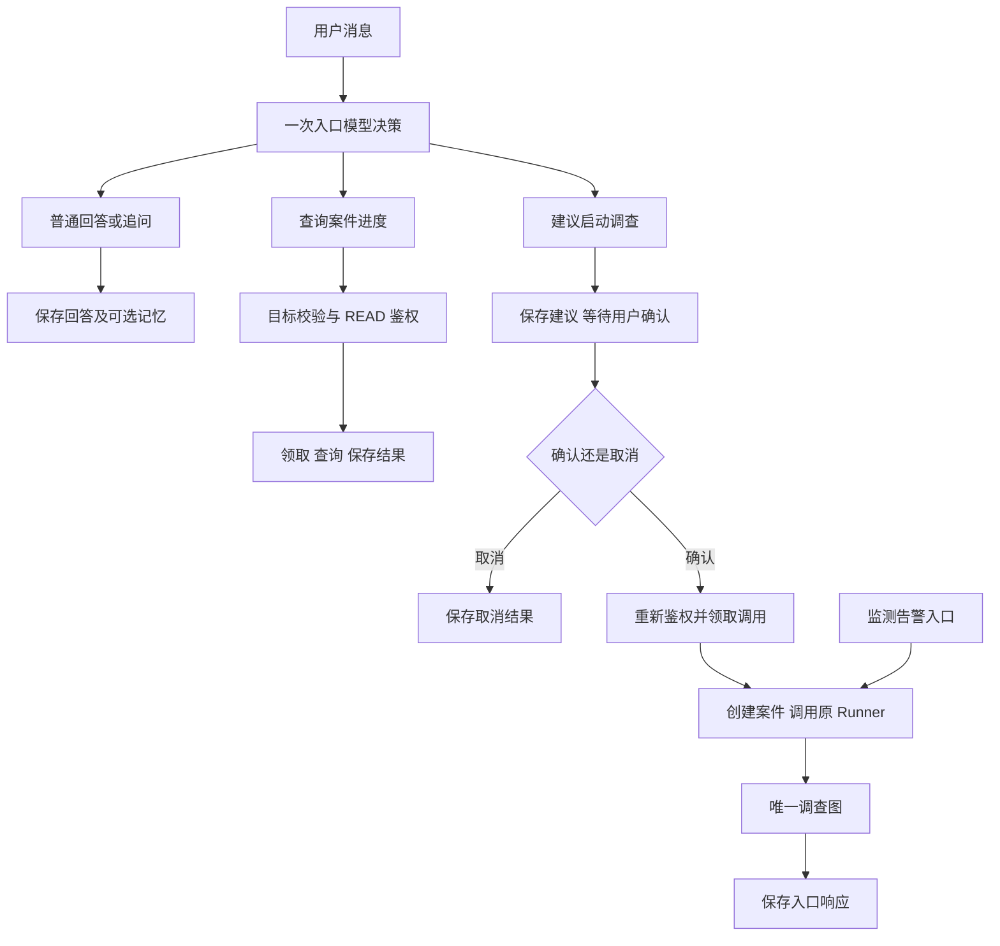

# 聊天入口完整调用链：模型决策、用户确认、并发幂等与数据库事务

- 记录日期：2026-11-13，时区 Asia/Shanghai（UTC+08:00）。
- 关键词：chat、confirm_chat、prepare_entry、confirm_entry、execute_entry、inspect_entry、原生工具调用、用户确认、幂等、PostgreSQL 事务、运行锁、Runner。
- 文档性质：依据当日工作区源码整理的实现分析与审阅记录，不代表已经部署。
- 本次只新增文档，不修改业务代码、数据库或迁移。
- 当前实现：一次入口模型决策 + 原生工具请求 + 确定性分派，调查执行仍交给原 InvestigationRunner 和唯一调查图。
- 当前未实现：可靠后台交接、入口中断自动接续、前端确认页面、确认超时、长期累计聊天记忆。

## 目录

1. 先看完整链路与模块边界
2. HTTP 接口与身份来源
3. 六种编号及其生命周期
4. chat() 与 confirm_chat() 的注释理解
5. 四个核心函数逐段分析
6. Agent、工具声明与目标校验
7. 数据库表、写入时机与状态转换
8. 事务原子性、flush 和 return
9. 并发、锁与幂等
10. 鉴权、权限撤销与信息边界
11. 记忆、State、检查点与观测的区别
12. 失败窗口和重试场景
13. 用户提问整理
14. 后台执行方案与当前差距
15. 测试证据、限制和审阅清单
16. 源码索引

## 1. 完整链路与模块边界

```text
POST /chat/messages
  → principal：从部署认证函数取得 actor
  → 路由 chat：请求格式校验、错误映射
  → EntryServices.chat
      → prepare_entry
          → actions.begin：登记消息或识别重复请求（提交）
          → history_and_memories + assemble_context
          → ChatAgent.decide：一次入口模型调用（事务外）
          → parse_entry_decision：回答或一个原生工具请求
          → validate_entry_target：确定性核对目标
          → actions.save_decision：保存决定（提交）
      ├─ ANSWERED / REJECTED / FAILED 等：返回已保存视图
      ├─ PENDING_CONFIRMATION：返回等待确认，不创建案件
      └─ READY：execute_entry（通常为进度查询）

POST /chat/turns/{turn_id}/confirmation
  → principal
  → 路由 confirm_chat
  → EntryServices.confirm_chat
      → confirm_entry：登记确认或取消（提交）
      ├─ CANCELLED：返回，不执行调查
      └─ READY：execute_entry
          → 检查会话归属、已保存决定和业务权限
          → actions.start：领取调用，写入 STARTED（提交）
          → 事务外执行
              ├─ get_investigation_progress → _progress
              └─ start_investigation
                  → _create_case：创建/复用案件与第一轮
                  → _run_case
                  → InvestigationRunner.ainvoke
                  → 唯一调查图
                  → _progress：组装进度文字
          → actions.finish：动作结果与聊天响应（同事务提交）

GET /chat/turns/{turn_id}
  → principal → inspect_chat → inspect_entry
  → owned_turn + actions.state + 必要的案件 READ 校验
  → 返回数据库视图，不执行、不自动修复
```



聊天模型负责提出“回答、追问、查进度、启动调查”之一。应用代码负责身份、目标检查、确认、权限、登记和交接。调查图负责生成计划、执行正式任务、解释和轮次推进；聊天不复制这些业务阶段。

“入口只调用一次模型”只指入口决策，不表示整个调查只有一次模型调用。进入 Runner 后，规划、工具请求生成、Observation 仍可能调用模型。

## 2. HTTP 接口与身份来源

| 接口 | 应用方法 | 输入与作用 |
|---|---|---|
| POST /chat/messages | chat(request, actor=...) | 新消息，或原请求重发；普通回答直接返回，查询立即执行，启动等待确认 |
| POST /chat/turns/{turn_id}/confirmation | confirm_chat(turn_id, confirmation, actor=...) | 确认/取消已保存的启动建议；确认后当前实现会等待执行 |
| GET /chat/turns/{turn_id} | inspect_entry(turn_id, actor=...) | 按原请求查询记录，不执行工具 |
| POST /investigations/from-alert | from_alert(request, actor=...) | 告警建立案件后进入同一个 Runner；不经过聊天确认 |

`principal()` 调用 `app.state.authenticate(request)`，支持同步或异步认证，并校验返回身份格式。actor 不从模型、消息正文或任意客户端身份头获取。未配置认证/业务依赖返回 503，认证失败返回 401。部署仍必须接入真实身份系统；代码中存在回调不等于已经部署登录和权限系统。

`invoke()` 把未处理的 PermissionError 映射为 403，ChatNotFoundError 为 404，冲突/忙碌/恢复阻断为 409，账本完整性错误为 500，其他 Exception 为 503；不向前端暴露异常原文。

`entry_response()` 在无最终 result 时返回 202；已有成功 result 返回 200；失败 result 根据 error_code 返回 403/404/409/503。注意 execute_entry 的执行期错误会先转为 ChatResponse，和执行前直接抛给 invoke 的错误不是同一路径。

202 在当前代码中也用于等待确认或已领取，不证明任务已经可靠投递后台。接口没有实现 Outbox，也未添加 Location、Retry-After 协议头。

## 3. 编号与数据归属

| 字段 | 谁填写 | 标识什么 | 关键约束 |
|---|---|---|---|
| actor | 服务端认证 | 当前操作者 | 不是请求正文提供的授权事实 |
| request_id | 客户端 | 一次请求/一次用户发送动作 | 同一次重发不变，新消息换编号 |
| conversation_id | 服务端首次生成，后续客户端携带 | 整段会话 | 多次请求共享；不允许串用别人的会话 |
| turn_id | 服务端 stable_id | 这一次聊天请求 | stable_id("turn-", actor, request_id)，不是案件 ID |
| call_id | 模型供应商响应 | 原生工具调用的来源编号 | 保存在决定中，不作为服务端可信调用主键 |
| invocation_id | 服务端 | 当前 turn 提出的入口调用 | stable_id("entry-call-", turn_id)，当前最多一个调用 |
| investigation_id | 服务端生成，或查询参数指定 | 调查案件 | 启动时 stable_id("case-chat-", turn_id)；等待确认时只是预分配 |
| round_id | 服务端 | 案件第一轮 | stable_id("round-", case_id, 1) |
| decision_digest | 服务端 | 被确认决定的摘要 | 用于确认绑定和完整性核对，不是签名或权限令牌 |

`stable_id()` 对参数序列的 JSON 做 SHA-256，再加前缀。不是每次生成随机 ID，也不把同一句自然语言自动归并为一个业务请求。相同用户使用另一个 request_id，仍可能创建另一项调查；这不等于实现“同模型只能有一个案件”的业务去重。

request_id 在当前设计中按用户范围识别，而非仅会话范围。相同用户把同一 request_id 投向不同会话，也不能被解释为两个新请求。

首次消息可不带 conversation_id，由服务端稳定生成。网络重发必须保持完整规范请求不变：首次省略会话 ID 的请求，不能在重发时自行补上返回的 ID；虽然可能指向同一会话，但请求摘要不同。后续真正的新消息才带该会话 ID 并使用新 request_id。

## 4. chat() 和 confirm_chat() 的代码注释理解

两个层次都有同名函数，必须结合文件阅读：路由函数是 HTTP 适配，EntryServices 方法是应用行为。

### 4.1 HTTP 路由 chat

```python
@router.post("/chat/messages")
async def chat(body: ChatRequest, request: Request, actor: str = Depends(principal)):
    # FastAPI 根据 ChatRequest 校验正文；Depends 从服务端认证得到 actor。
    # invoke 统一转换业务异常；entry_response 把业务视图转为 HTTP 响应。
    return entry_response(await invoke(request.app.state.entry_services.chat(body, actor=actor)))
```

路由不分析意图、不保存模型决定，也不直接调用调查节点。

### 4.2 应用层 chat

```python
@trace_chat
async def chat(self, request, *, actor):
    # 登记消息、复用旧决定，或完成本次模型决策并保存。
    view = await self.prepare_entry(request, actor=actor)
    if view.status == "READY":
        # 查询工具初始为 READY；已确认但尚未领取的启动调用也可能为 READY。
        return await self.execute_entry(view.turn_id, actor=actor)
    # 普通回答、等待确认、取消、已完成或不确定状态不在这里盲目再执行。
    return view
```

`*` 要求 actor 作为关键字参数传入；`async def` 表示可等待异步操作，不表示后台任务。`@trace_chat` 包装原函数，创建 chat-request 观测并记录状态/错误码。它不是数据库事务、锁或检查点。Langfuse 默认关闭，观测失败不代替或吞掉业务失败。

### 4.3 HTTP 路由 confirm_chat

```python
@router.post("/chat/turns/{turn_id}/confirmation")
async def confirm_chat(turn_id: str, body: EntryConfirmation,
                       request: Request, actor: str = Depends(principal)):
    # 路径选定原 turn；正文只能确认原 invocation 和摘要，不能换目标。
    return entry_response(await invoke(
        request.app.state.entry_services.confirm_chat(turn_id, body, actor=actor)))
```

确认对象是“对指定模型启动这一次新调查”，不是认可模型结论，也不授权训练、审批、发布或回滚。当前所有聊天启动调用都需要确认，即使消息已经明确说“启动”；这是当前产品策略，不是幂等或 LangGraph 的技术要求。

### 4.4 应用层 confirm_chat

```python
async def confirm_chat(self, turn_id, confirmation, *, actor):
    # 先在独立事务内登记确认/取消；confirm_entry 本身不执行工具。
    view = await self.confirm_entry(turn_id, confirmation, actor=actor)
    if view.status == "READY":
        # 只有确认后准备就绪才执行。执行失败不会回滚先前已经提交的确认。
        return await self.execute_entry(turn_id, actor=actor)
    return view
```

重复确认同一个已成功调用会返回原状态；不能把已取消改为确认，也不能在原确认上换一个模型。

## 5. 四个核心函数逐段分析

这里“四个核心函数”指 prepare_entry、confirm_entry、execute_entry、inspect_entry。它们位于应用入口，内部通过 action_repository 做短事务。上一节另行覆盖 HTTP 与应用层的四个同名入口函数，避免名称歧义。

### 5.1 prepare_entry：保存消息与模型决定

输入：ChatRequest 和可信 actor。输出：EntryActionState。

1. 校验 actor 的 Identity 格式。格式合法不是身份认证，认证由 HTTP principal 完成。
2. 开启短事务调用 actions.begin。该方法计算 turn_id 并取得请求级事务 advisory lock。
3. 旧 turn 已存在时，核对 owner、当前聊天权限、协议和请求摘要。若已有可靠决定/响应，直接复用；若仍为 DECIDING，抛 ChatBusyError，不再调用模型。
4. 新 turn 通过 claim_turn 建立/核对会话，写入用户消息和 STARTED，然后结束事务提交。
5. 开只读 Session 核对归属并读取近期历史、记忆；退出 Session 后组装上下文。
6. 在 asyncio.timeout 中通过 asyncio.to_thread 调用同步 ChatAgent.decide；等待模型时没有上述事务行锁。
7. 如果返回 ToolInvocation，则 validate_entry_target。目标不明或冲突转成可展示追问，并保存为 REJECTED；不是立刻执行。
8. 模型、读取或组装阶段的普通 Exception 会尝试保存 FAILED/DEPENDENCY 响应。没有可靠决定时不伪造工具调用。注意这一较宽捕获可能把历史完整性/授权等异常概括为依赖失败，故不能从该错误码推断一定是模型故障。
9. 正常路径开启新事务，owned_turn(write=True) 重新检查并加锁，save_decision 保存不可变决定。普通回答及非空记忆在此完成；查询 READY，启动 PENDING_CONFIRMATION。
10. actions.state 组装视图，退出事务提交后返回。

`asyncio.to_thread` 只把同步 SDK 调用放到线程，避免阻塞事件循环；超时取消等待通常不能强制停止已运行的 Python 工作线程/供应商请求。当前不自动再次调用模型，但不能声称供应商费用一定不会发生。取消、进程退出或最后落库失败可能留下 STARTED/DECIDING。

### 5.2 confirm_entry：保存用户确认事实

1. 对 EntryConfirmation 重新序列化校验。confirmed 必须是真正 bool；正文不允许 actor、工具名、新目标等额外字段。
2. 短事务内 owned_turn(write=True)：必须是原请求用户，且有 chat:read/chat:send。
3. actions.confirm 锁定决定行并 read_decision 验证完整性。
4. 仅接受 start_investigation，invocation_id 和 decision_digest 必须与原决定一致。
5. 未确认时必须是 PENDING_CONFIRMATION；保存 confirmed、confirmation_actor、confirmed_at。
6. true → READY；false → CANCELLED，并在同事务完成一条“已取消”的成功聊天响应。
7. 已确认的相同选择与相同 actor 直接复用；不同选择冲突，不能原地改写。
8. 返回视图前，若携带已保存案件结果，还重新检查案件 READ。

确认完成不等于执行完成。确认后、执行前崩溃可留下 READY；用户显式重发相同确认或原聊天请求时，包装函数可以继续领取 READY，但没有定时程序自动推进它。

### 5.3 execute_entry：检查、领取、执行、结算

第一段：短事务内检查并领取。

```python
async with self.sessions.begin() as session:
    turn = await actions.owned_turn(..., write=True)  # 会话身份、权限及 turn 行锁
    row = await session.get(EntryDecisionRow, turn_id, with_for_update=True)
    decision = actions.read_decision(row, turn)      # 从可靠记录解析，不重新问模型
    # 无记录则冲突；STARTED/终态返回原视图，不重跑。
    # 只有 READY + ToolInvocation 可以继续。
    # 查询检查 READ；启动检查 CREATE、READ、CONTINUE。
    row, claimed = await actions.start(session, turn)
    # start 再检查 READY，启动必须 confirmed is True。
    # 写入 STARTED 和 started_at，读取原始 message、case_id。
# 离开上下文才 commit；提交失败不会继续执行下面工具。
```

第二段：事务外执行业务。

```python
if decision.name == "get_investigation_progress":
    answer = await self._progress(actor, case_id)
else:
    source = InitialPlanningInput(
        user_query=UserQuery(query=message, model_id=decision.arguments.model_id),
        available_capabilities=["KNOWLEDGE_RETRIEVAL"],
    )
    result_case = await self._create_case(actor, case_id, source)
    await self._run_case(actor, case_id)  # 原 Runner，不是后台投递
    answer = await self._progress(actor, case_id)
```

当前启动输入明确只提供知识检索能力，不代表任意工具能力已接入调查结果和账本。

执行成功后生成 ChatResponse。执行阶段 PermissionError、ChatNotFoundError、LedgerConflictError、RecoveryBlockedError 视为已知失败，映射 FORBIDDEN/NOT_FOUND/CONFLICT；其他 Exception 生成 FAILED/DEPENDENCY 响应，并把动作结算为 UNCERTAIN。已知错误归类不证明此前零副作用，例如案件创建后 Runner 被阻断仍可能已有案件。

第三段：重新开启短事务，owned_turn(write=True) 重新检查会话权限，actions.finish 校验原 turn/会话/案件关联，再把动作结果和聊天响应一起保存。

取消/进程退出等不一定被 except Exception 捕获；最终写入阶段也在执行 try/except 之外。因此这些情况可留下 STARTED。不能把异常处理理解为任何中断都会被保存为 FAILED。

### 5.4 inspect_entry：读取，不领取也不恢复

只读 Session 内执行 owned_turn → actions.state → _authorize_entry_result，返回状态。state 读取两张表，不运行工具、不更改 READY/STARTED，也不把调查账本实时结果自动同步成聊天 SUCCEEDED。

若有已保存 result.investigation_id，必须再次检查案件 READ。只返回预分配关联身份或调用状态时不等于读取了案件内容。客户端应理解 investigation_id 可能尚不存在。

inspect 不保证拿到一个跨所有并发写入的固定数据库快照；当前未指定更强隔离或行锁。并发提交附近观察结果可能稍后变化，不能据一次 GET 判定后续没有继续推进。

### 5.5 案件交接的必要辅助函数

| 函数 | 输入与实际行为 | 不负责什么 |
|---|---|---|
| _resource_permission | 调用注入的案件授权回调；只有明确 True 才允许，回调异常按拒绝 | 不从自然语言推导权限 |
| _create_case | 将输入规范为 InitialPlanningInput，检查 CREATE；案件级事务锁后加载或创建 Investigation，并登记 Round 1 | 不生成候选计划，不运行工具 |
| _load_runtime | 在给定 Session 中加载 canonical 案件和第一轮，加载并验证可信环境 | 不相信客户端 State 来确定案件归属 |
| _runtime | 为 _load_runtime 提供独立 Session 的便捷封装 | 不开启调查执行 |
| _run_case | 获取可执行 Runtime，包装 InvestigationInvocation 后 await runner.ainvoke | 不持有另一套任务循环，不发送后台消息 |
| _progress | READ 鉴权后读取第一轮 AcceptedPlan、Run 及该 Run 已选择的 Result，拼接进度文字 | 不重新让模型下结论，不返回知识正文，不自动恢复 |
| _authorize_entry_result | 已保存响应关联案件时重新检查 READ | 不把聊天 owner 当作所有案件的永久读取权 |

_create_case 的重复案件处理不是覆盖：原案件存在时读取正式记录，若 planning_input 不同则冲突；相同则复用，保留原 created_by。登记案件及第一轮在同一事务。案件与轮次 ID 提前确定，只是便于可靠关联，不代表生成了业务计划。

_load_runtime 的 execute=False 不构造执行工具绑定；execute=True 才通过 tools_for(actor, canonical_planning_input) 构造本次工具。工具授权范围来自可信组合入口，不来自模型 arguments。

Runner.ainvoke 先授权，确定既有/新建的运行身份，claim 后读取和校验检查点，再执行或复用唯一调查图。新计划仍在图内 prepare_plan 生成、确定性校验并正式接受；入口不先造出计划来满足 Runner 参数。

同一案件的进度查询并不等于再次调用 Runner，也不会为展示进度重新执行调查。当前最终回答说“仍为 OPEN”，只是首轮阶段的既定输出，不是已经实现完整案件关闭状态机。

## 6. 模型、工具声明与目标校验

### 6.1 ChatAgent.decide 的输入输出

输入 payload：message 本次原文、recent_history 近期问答、historical_memory 选中记忆、explicit_target 调用方明确绑定的案件/模型。history 是近期原文投影，memory_context 是分类记忆，两者职责不同。

options 包含 model、system/user messages、JSON 输出格式、两个注册工具的 schema、tool_choice=auto、parallel_tool_calls=False。JSON 序列化解决传输结构和转义，不会自动保证语义正确或消除提示注入。

不再单独调用分类模型。回答/追问用 ChatDraft；查进度/启动用一个原生 ToolInvocation。工具返回后的进度文字由确定性服务器代码生成，没有第二次模型润色和自由工具循环。

### 6.2 parse_entry_decision 的确定性检查

- 只有一个完整 choice，没有 refusal、截断或旧 function_call。
- 工具分支必须 finish_reason=tool_calls，且恰好一次 function call。
- 名称必须在本次提供的注册列表内，正文不能同时输出非空回答。
- 参数必须是 JSON 对象；重复键、NaN 等非法常量被拒绝，参数符合对应 Pydantic 契约。
- 普通回答必须 finish_reason=stop，符合 ChatDraft；聊天 memory 不允许产生 execution_summaries。

这些证明结构受约束，不证明模型理解了用户意愿。工具说明属于模型输入，真正执行仍须目标门禁、确认和鉴权。

### 6.3 validate_entry_target 的能力与限制

明确绑定优先：绑定模型 A 却请求工具模型 B，拒绝；绑定案件却要新建模型调查，同样拒绝。没有显式绑定时，目标必须以独立 ID 出现在当前消息中，不从历史补造。它会避免把 credit-v30 中的子串 credit-v3 当作目标。

但“消息含有 credit-v3”不代表用户要求启动，例如“不要调查 credit-v3”。否定、咨询和假设主要由模型决策约束及质量评测负责；当前启动还需用户显式确认。模型目标检查不查询模型注册表，不能据此宣称模型已存在且归属正确。

## 7. 数据库记录与写入时机

| 表/层 | 内容 | 权威范围 |
|---|---|---|
| chat_conversations | conversation_id、owner_id、创建时间 | 会话归属 |
| chat_turns | 用户、消息、请求摘要、请求状态、最终响应、记忆及摘要、结束时间 | 本次聊天请求的输入与交付 |
| chat_entry_decisions | 完整原请求、完整决定、决定摘要、调用与案件关联、确认、领取时间、动作状态 | 一次入口建议的确认和交接 |
| 调查账本与检查点 | 案件、轮次、候选/正式计划、阶段尝试与结果、Observation、图进度 | 调查执行事实与恢复 |
| Langfuse | 可选状态、工具名、模型用量、运行耗时 | 运维观测，不是业务权威记录 |

旧 intent_payload/intent_digest 与 action 枚举仍存在，为历史只读兼容；新写入 action 固定 ENTRY_DECISION，HTTP ChatRequest 没有 action 参数。

### 7.1 写入时间表

| 时刻 | 方法 | 写入内容 | 当时是否已创建案件 |
|---|---|---|---|
| 收到新消息 | begin → claim_turn | 会话（必要时）、用户消息、请求摘要、ChatTurn STARTED | 否 |
| 普通模型回答 | save_decision → complete_turn | 决定 ANSWERED、最终回答、可选记忆 | 否 |
| 目标校验拒绝 | save_decision | 原工具建议 REJECTED、追问响应；无工具执行 | 否 |
| 建议查询 | save_decision | READY、查询参数、关联现有案件 | 此案件应已存在，执行时仍核查 |
| 建议启动 | save_decision | PENDING_CONFIRMATION、启动参数、预分配 case_id | 否 |
| 用户确认/取消 | confirm | actor、bool、时间；READY 或 CANCELLED | 否 |
| 准备执行 | start | STARTED、started_at | 启动分支尚未创建 |
| 启动执行中 | _create_case、原 Runner | 案件、轮次、计划、阶段结果、检查点等 | 是，分次事务 |
| 执行返回 | finish → complete_turn | 动作终态、最终响应、关联案件 | 可能已存在，失败不等于不存在 |
| GET 查询 | state / inspect_entry | 不写入 | 不改变事实 |

聊天记忆实际存于 chat_turns.memory_payload/memory_digest，不是这里另写一张聊天记忆表。只有普通回答的非空记忆才保存；查询/启动响应不提取聊天记忆。

### 7.2 两种 STARTED 不是一回事

ChatTurn.status=STARTED 表示整条请求还没最终交付，可能正在问模型、等待用户确认，或执行调查。

EntryDecision.status=STARTED 表示这个入口工具调用已经被领取。其状态只有保存决定后才存在。

| 动作状态 | ChatTurn 状态 | result |
|---|---|---|
| 无决定，模型处理中 | STARTED | None；state 投影为 DECIDING |
| ANSWERED / REJECTED | SUCCEEDED | 成功响应；REJECTED 是成功交付追问，不是执行成功 |
| PENDING_CONFIRMATION / READY / STARTED | STARTED | None |
| SUCCEEDED / CANCELLED | SUCCEEDED | 成功响应；取消不是调查完成 |
| FAILED / UNCERTAIN | FAILED | 失败响应 |
| 模型阶段失败、没有决定行 | FAILED | 失败响应 |

DECIDING 是 state 计算出的视图状态，不是 EntryDecisionRow 中实际存储的一行状态。EntryActionState.result.status 仅支持 SUCCEEDED/FAILED，因此 UNCERTAIN 位于外层 status，内层仍是 FAILED。

启动状态路径：PENDING_CONFIRMATION → READY 或 CANCELLED；READY → STARTED → SUCCEEDED/FAILED/UNCERTAIN。查询直接从 READY 开始。当前终态不能原地修改，也不支持 CANCELLED → READY。

## 8. 数据库事务与原子性

### 8.1 一条业务调用有多次事务

```text
T1 登记消息，提交
  → 外部模型调用
T2 保存决定；普通回答连同响应/记忆提交
  → 用户等待（启动分支）
T3 保存确认/取消，提交
T4 检查并领取工具，提交
  → 创建案件事务、Runner 自己的多次事务与外部调用
T5 保存动作结果和聊天响应，提交
```

查询没有 T3，普通回答没有 T3～T5。T1～T5 是本文逻辑标号，不是源码变量或数据库统一全局事务。

### 8.2 flush 不等于 commit

`session.add(row)` 把对象加入当前 Session；`await session.flush()` 把 SQL 发给数据库，获得约束检查等反馈，但尚未提交。

```python
async with sessions.begin() as session:
    await actions.save_decision(...)  # 内部 flush，不是独立 commit
    return await actions.state(...)  # 先计算返回值
# __aexit__ 提交成功之后，调用者才真正收到返回值；提交失败则抛异常。
```

因此 save_decision 的“先保存决定，再保存回答”仍在同一事务内；不能把一次 flush 描述为已经可靠提交。若提交失败，该事务内决定、回答、记忆整体回滚。

### 8.3 原子性保证什么

同一事务内：确认取消与取消响应；普通回答的决定、响应与记忆；调用终态与最终响应，应一起成功或一起失败。

跨事务：确认成功不保证案件创建成功；案件创建成功不保证 Runner 完成；Runner 已提交不保证聊天结果保存成功。这些窗口靠稳定身份、记录、账本和明确恢复规则处理，不能用单个事务覆盖网络模型和所有阶段。

### 8.4 数据库约束的实际作用

- 会话与用户复合 FK、防止请求归属脱离会话。
- uq_chat_active：每会话最多一个 status=STARTED 的请求。
- 决定行 FK 关联 turn，invocation_id 唯一。
- confirmed、confirmation_actor、confirmed_at 要么都为空，要么完整填写。
- protect_entry_decision：输入/身份不可改、确认一经写入不可改、终态不可改/删、只允许声明的状态转换。
- check_entry_finalization：延迟约束触发器在事务结束检查动作状态与 ChatTurn 结果组合，防止只交付一半。

检查约束、触发器和摘要核对不等于自然语言真实。SHA-256 是一致性校验，不是抵御拥有任意数据库管理权限攻击者的签名机制。

## 9. 并发、锁与幂等

### 9.1 并发不只指多线程

A、B 可以是同一进程两个 asyncio Task、不同线程、多个 Web Worker，或不同服务器实例。只要都访问同一 PostgreSQL 并遵守协议，数据库锁可协调；Python 的普通进程内锁不能覆盖多个进程。

`await` 允许其他协程在等待期间推进；同一线程也可能出现交错请求，不需要两颗 CPU 同时执行。

### 9.2 四类锁的边界

| 机制 | 范围与时长 | 保护对象 |
|---|---|---|
| 请求 advisory xact lock | riskmind:chat-turn:{turn_id}，事务结束释放 | 相同用户请求编号的并发登记，包括首条记录尚不存在 |
| 会话 advisory xact lock + uq_chat_active | riskmind:chat:{conversation_id}，仅登记事务 | 同一会话活动请求检查和创建 |
| FOR UPDATE 行锁 | ChatTurn / EntryDecision，确认、领取、结算事务 | 已存在记录的检查与状态变更 |
| Runner 会话 advisory lock + generation | 独立连接，覆盖调查运行；阶段提交再 fencing | 同一调查运行不被旧执行者继续提交 |

入口短事务的行锁提交后已经释放，不会持有两分钟等模型。Runner 是另一个层次：专用 AUTOCOMMIT 连接持会话锁，而非维持一个覆盖外部调用的长事务。generation 是运行代次，不是线程编号，由接续取得执行权等代码推进；检查数据库当前代次可阻断旧代次提交。

数据库事务锁与业务状态是配合关系：锁解决“谁先检查并修改”，持久化 STARTED 解决“锁释放以后，后来的请求知道已经领取”。

### 9.3 两个执行请求同时到达

```text
A 锁住 turn 和决定行                  B 等待行锁
A 检查 READY + 当前权限
A 更新 STARTED，提交
A 执行业务                            B 获得行锁
                                     B 读到 STARTED，返回，不执行业务
```

先查状态、释放锁、再另一个事务改状态，会产生两边都看到 READY 的窗口；当前把检查与修改放在同一事务。

### 9.4 两个确认请求同时到达

相同确认 A 先写 READY 并提交，B 随后读到相同已确认选择并复用。两边包装函数都可能尝试 execute_entry，但行锁与 STARTED 仅允许一次领取。若 A 取消、B 确认，先提交的一方固定选择，后一方冲突，不把取消悄悄覆盖。

### 9.5 幂等不是执行成功承诺

同一请求身份重复提交，关联同一 turn/call/case，已保存结果可复用。当前更准确地说实现了请求幂等与一次调用领取保护；不能宣传端到端 exactly-once，也不能把“阻止重试”当作“保证完成”。

STARTED 提交后、业务开始前退出，就可能一次也没执行但仍阻止重领。外部模型或工具的实际调用次数，还取决于阶段账本和重试策略，入口状态不能证明它们从未重复。

### 9.6 同一会话的新消息为什么可能被拒绝

一个 turn 等待确认时 ChatTurn 仍为 STARTED，部分唯一索引和登记检查会阻止同会话另一个新 turn。当前前端不能把“确认”当作普通新消息提交，必须调用 confirmation 接口。

这是一条较保守的顺序策略，不是所有聊天产品都必须如此；没有确认过期机制意味着放弃操作可能持续阻塞该会话，需在后续产品设计中明确处理。

## 10. 鉴权与权限撤销

| 边界 | 检查内容 | 为什么需要 |
|---|---|---|
| principal | 当前真实用户身份 | 拒绝伪造 actor |
| begin / owned_turn | 会话 owner、turn.actor、chat:read；写操作再 chat:send | 防止跨用户访问与撤权后继续写 |
| 目标 Gate | 工具目标是否明确、与绑定一致 | 防止模型换对象；这不是授权 |
| confirm | 原调用、原摘要、同一用户、明确 bool | 防止误确认另一条建议或事后改意愿 |
| execute 查询 | canonical 案件和轮次、READ | 查询不推导出 CONTINUE 权限 |
| execute 启动 | CREATE、READ、CONTINUE | 聊天权限不能替代案件权限 |
| _create_case | 再查 CREATE；核对原输入 | 实际创建点保护副作用和一致性 |
| Runner / 阶段 | canonical runtime、READ/CONTINUE、工具范围、运行 fencing | 执行与结果复用的独立边界 |
| 最终结算 | 当前会话 READ/SEND | 长操作后权限可能变化 |
| 缓存结果 / inspect | 若 result 关联案件，则重查 READ | 曾经可读不等于当前仍可读 |

授权不全是数据库自动得出的：案件与轮次记录从数据库加载，是否允许由部署注入的授权回调决定。回调可能访问本地规则或外部权限系统，当前代码没有证明它与业务事务共享一致性。

跨事务、模型调用和工具执行前后重验有必要，因为时间已经过去；同一事务内部分重复加载/校验可单独评估合并，不能因此删掉不同时间点的保护。

最后一次检查之后立刻撤权，仍存在并发窗口。当前“再次鉴权”只能说明检查当时允许，不能保证撤权提交后所有旧操作立刻停止或无旧结果可提交。若业务要求严格撤权顺序，须让撤权与提交共享锁/权限版本等协调机制；当前未实现。

## 11. 记忆、状态、检查点与观测

### 11.1 state() 不是存状态的容器

`await actions.state(session, turn)` 从 ChatTurnRow 和 EntryDecisionRow 读取，并校验决定/响应后组装 EntryActionState。Repository 是数据库访问代码，业务记录在 PostgreSQL，不在 Python 文件中。它不是 LangGraph 的 State，也不保存新的阶段结果。

### 11.2 四种材料不要混用

| 材料 | 回答的问题 | 不能替代 |
|---|---|---|
| 消息与聊天记忆 | 用户说过什么、可参考什么偏好与背景 | 执行事实、权限 |
| 入口动作记录 | 建议什么、是否确认、是否已领取、交付什么结果 | 调查节点进度 |
| LangGraph 检查点 | 调查图保存到哪个边界、后续节点是什么 | 外部副作用幂等 |
| 调查阶段账本 | 哪次操作、尝试、产物及结果选择已提交 | 活跃执行权与当前权限 |

调查图有 checkpointer；聊天入口当前没有独立聊天图。作为参考，DevF 的 ConversationState 是模型/工具循环的内存工作数据，其聊天 compile 没配置持久化 checkpointer；它另行落库 ChatMessage、封存和记忆。不能据“没有 checkpointer”推断“没有保存聊天历史”，也不能把历史原文视为可从任意中断节点接续的完整检查点。

### 11.3 当前记忆读取范围

history_and_memories 先取最近十个成功候选 turn，再过滤工具响应，所以实际提供给模型的普通问答可能少于十轮；不是“保证召回最近十个普通问答”。历史按时间顺序，单条正文最多截取 2000 字符；记忆按近期优先传组装器。

assemble_context 按 12000 字符序列化预算选择完整记忆正文，不做模型摘要；超预算跳过整条。这个预算只覆盖记忆结构，不是系统提示、历史、工具 schema、本次消息和输出的全模型 token 上限。历史正文切片仍可能截掉语义，不能声称上下文永不丢信息。

### 11.4 trace_chat 的实际范围

chat() 创建根 observation，decide() 记录 entry-decision generation 与供应商实际返回用量。只导出工具名、状态等允许字段，不导出正文和工具参数。confirm_chat 未单独装饰 trace_chat，调查内部也不是全部模型调用已逐项计费观测。观测不能代替业务数据库、授权审计或恢复机制。

## 12. 具体场景与失败窗口

| 场景 | 已可靠保存 | 当前响应/行为 | 不应推断 |
|---|---|---|---|
| 正常问 PSI | 用户消息、决定、回答、可选记忆 | ANSWERED / 200 | 没有创建案件 |
| “查那个”缺目标 | 回答型追问或目标拒绝记录 | ANSWERED 或 REJECTED | 结构合法不等于模型已正确理解 |
| 明确查询案件 | 决定 READY，随后领取和结算 | 同次 HTTP 查询，成功 200 | 查询不授予继续调查 |
| 明确启动新调查 | PENDING_CONFIRMATION、预分配 case_id | 202，等待用户 | case_id 非空不证明案件存在 |
| 确认后撤销案件权限 | 确认 READY；执行前检查拒绝 | 403；未领取时仍可保持 READY | 不是自动取消，恢复权限后仍需显式请求 |
| 模型正在请求时断网 | T1 用户消息可能已提交 | 原请求重发若 DECIDING 则 409 | 断网不证明服务端停止或模型未计费 |
| 决定已提交但响应丢失 | 原决定与 ID 都在 | 原 request_id + 原完整输入复用 | 不应换新 ID 来“重试” |
| 确认提交后、领取前崩溃 | READY 和确认记录 | 相同确认/原消息重发可领取 | 没有自动后台消费者 |
| STARTED 提交后、创建案件前退出 | 已领取、预分配 case_id | GET/重复执行返回 STARTED；不自动重领 | 不证明案件已创建 |
| 案件已创建，Runner 途中退出 | 案件及部分阶段结果可能在 | 按 turn 定位，授权核实原账本 | 不应换请求 ID 启动第二项调查 |
| Runner 完成，最后保存响应失败 | 调查事实已提交，入口可能 STARTED | inspect 定位；人工可核实并调用原 Runner | 入口不会自动变成 SUCCEEDED |
| 执行中未知异常 | 某些业务结果可能已保存 | 若结算成功，外层 UNCERTAIN/内层 FAILED | FAILED 响应不证明零副作用 |
| 用户取消 | CANCELLED、取消响应 | 200，不执行 | HTTP 200 不代表调查成功 |
| 权限撤销导致最终结算失败 | 调查可能已有结果，入口可能 STARTED | 不绕过授权强行保存；需核实 | 已经执行不授予当前读取权限 |

客户端断开连接不保证服务端协程一定取消；取决于服务器、框架和部署。进程崩溃则内存执行肯定无法靠当前 HTTP 协程自行恢复，必须依据持久化材料重新判断。

## 13. 用户提问与准确回答

### Q1：为什么新消息不能一直使用同一个 request_id？

因为它标识一次发送动作，不是整段会话。两条不同正文用同一个编号，服务端会拒绝输入摘要不一致。会话关联使用 conversation_id。

### Q2：超时重发为什么必须保持原编号？

前端不知道服务器是没收到、正在处理，还是处理成功但响应丢失。原编号允许查到原记录；新编号可能被当作另一项业务意图。前端应在第一次发送前保留编号和正文，重试沿用，不能让用户手工处理。

### Q3：确认时确认什么？

确认“按原建议对指定模型创建并启动新调查”。invocation_id 定位建议，decision_digest 固定内容，actor 来自当前认证。不是确认结论、正式计划内容，也不是批准未来生产变更。

### Q4：state 的状态保存在哪里？

数据库两张表保存不同层次状态，state 只组装返回值。没有决定行时可投影 DECIDING，不能把所有视图状态都理解成一张数据库表里的字段值。

### Q5：actions.start 为什么在执行之前？这算幂等吗？

先原子领取，才能阻止并发请求都执行。它是幂等的一部分，但留下“已领取、尚未执行”的失败窗口，所以不是完整可靠任务执行方案。

### Q6：为什么不把整个调查放在一个数据库事务？

模型/检索耗时不稳定，长事务会占连接、长时间持锁，并且数据库不能回滚供应商已发生的调用。应短事务记事实，外部调用在事务外，用账本和恢复协议处理窗口。

### Q7：这些问题只有多线程才发生吗？

不是。同进程异步协程在 await 处交错，多进程和多机器更常见。数据库锁协调共享记录，进程内锁无法替代。

### Q8：既然有 Runner 锁，为何入口还要锁？

入口保护聊天决定、确认和请求领取，Runner 保护调查运行。Runner 不替聊天消息防止重复模型决策，入口锁也不知道阶段结果如何复用。两者是不同粒度，不是同一份业务循环。

### Q9：重复校验与检查后撤权有什么关系？

前后跨时间点的检查可阻止已知撤权继续推进，但不能创造与外部权限服务共享的全局原子性。需要严格撤权线性顺序时，另行设计协调，不能用“再检查一次”宣称完全消除竞态。

### Q10：当前是不是后台执行了？

不是。confirm_chat 中 await execute_entry，后者 await _run_case。HTTP 仍等 Runner；async def 只是允许等待时处理其他任务。GET 能查询记录，不代表后台一定有消费者继续推进。

### Q11：换一个新 request_id 就能重新试一次吗？

技术上会是新请求，业务上可能造成重复案件。发生不确定结果应先按原 turn 查案件并核实；当前系统没有自动把相似自然语言请求合并的机制。

### Q12：查询状态是否会实时回查原 Runner 并修正结果？

不会。inspect_entry 返回入口登记视图；实时案件状态需进度工具，修复入口交付需要明确核实流程。不能把只读 GET 悄悄变成恢复或重复执行入口。

## 14. 后台交接：建议方案，当前未实现

拟议目标：确认后在同事务写入确认和 Outbox 待投递记录，提交成功返回 202；投递程序把 turn_id 交给 Celery Worker；Worker 从可信记录加载原 actor、重新鉴权并构建自己的依赖，调用原执行服务和 Runner。

```text
确认 + Outbox（同事务）→ 202
          ↓
可靠投递 → Celery Worker → 原 execute_entry / Runner → 同一数据库结果
          ↓
重复投递需幂等；进程中断需核实账本；前端按原 turn 查询
```

Outbox 用于避免“确认已保存，但消息未发送就崩溃”；投递可能重复，不能声称恰好一次消息。Celery 不保存案件权威状态、不决定图节点顺序。Worker 从消息取 turn_id，不信任消息携带任意 actor、工具客户端或可执行配置。

仅实现 Outbox 仍不足：当前 STARTED 会阻断重领，需要单独设计未执行/已部分执行/已完成的核实和接续语义，使用 Runner 原有锁、generation、账本与恢复策略。不得简单把 STARTED 重置 READY 或无限自动重试。

不要用 asyncio.create_task 充当可靠后台交接：进程退出时内存任务会丢失。该方案本次仅记录，不新增 Outbox 表、Celery 任务或恢复逻辑。

## 15. 测试证据、限制与审阅重点

历史开发验证记录：第三阶段默认测试 620 passed、120 skipped；真实 PostgreSQL 入口回归 11 passed。这些是上一阶段实际执行记录，不是本次重新运行的结果。本次只做文档和源码链接/片段核对，不重跑数据库或业务测试，不操作业务数据库。

| 行为 | 对应测试函数（test_entry_actions_postgres.py） |
|---|---|
| 确认前不建案件，确认后复用原 Runner | test_start_requires_confirmation_then_reuses_one_real_runner |
| 查询只读、回答记忆、目标拒绝 | test_read_only_action_answer_memory_and_rejection |
| 取消及撤权不执行 | test_cancel_and_permission_revocation_do_not_execute |
| 未知中断保留稳定案件关联 | test_unknown_interruption_keeps_stable_case_and_never_restarts |
| 并发确认/执行仅领取一次 | test_concurrent_confirmation_and_execution_has_one_claim |
| 模型失败与不确定结果不重试 | test_model_failure_and_dependency_uncertainty_are_not_retried |
| Runner 已提交、聊天结算失败后仍可定位 | test_runner_committed_but_response_commit_failed_can_be_located |
| 旧历史升级保留与读取 | test_migration_keeps_legacy_message_and_action_audit |
| 数据库拒绝错用户确认 | test_database_rejects_wrong_confirmation_actor |
| HTTP 全链路、取消、重发与权限 | test_http_chat_confirmation_and_original_runner |

其他证据：test_entrypoints.py 覆盖路由认证、输入和状态；test_entry_decision.py 覆盖原生工具响应；test_entry_action_gate.py 覆盖目标绑定；test_observability.py 覆盖观测隔离。通过测试证明的是所列场景，不证明真实模型理解正确、外部权限强一致或任意故障自动恢复。

审阅时应特别问：

1. 谁创建、读取和修改这个字段，权威来源是哪张记录？
2. 这次 flush 是否已经 commit，后面的外部调用是否确实在事务外？
3. 返回 READY/STARTED 是待执行事实还是完成事实，有没有误导前端？
4. 超时后原请求编号及完整输入能否保留，重复请求是否可能建第二个案件？
5. 长操作后撤权会在哪里被发现，哪些已经提交的事实不能回滚？
6. 同会话等待确认会阻塞其他消息，这是否符合产品需要？
7. _progress 当前只读第一轮、固定输出 OPEN，并非任意多轮案件状态服务；新轮次能力不能被提前宣称。
8. _progress 授权与后续结果读取跨 Session，不是权限与数据的统一原子快照；结果可能在读取期间变化。
9. 工具结果不进入聊天历史是主动权限边界，不能为“记忆更完整”绕过。
10. 新旧入口执行路径已收敛，最小旧数据读取不意味着恢复旧分类器。

## 16. 源码索引

以下均为当前仓库相对链接；函数名是主要定位锚点，避免代码增删导致固定行号漂移。

- [HTTP 入口](../backend/src/risk_platform/api/routes/entrypoints.py)：principal、invoke、entry_response、chat、confirm_chat、inspect_chat。
- [应用入口](../backend/src/risk_platform/entrypoints.py)：chat、confirm_chat、四个核心函数及案件交接辅助函数。
- [入口契约](../backend/src/risk_platform/conversations/contracts.py)：ChatRequest、ChatDraft、ToolInvocation、EntryConfirmation、EntryActionState、ChatResponse。
- [模型决策](../backend/src/risk_platform/conversations/agent.py)：ChatAgent.decide。
- [工具声明与 Gate](../backend/src/risk_platform/conversations/tools.py)：entry_tool_declarations、parse_entry_decision、validate_entry_target。
- [动作仓库](../backend/src/risk_platform/conversations/action_repository.py)：begin、owned_turn、read_decision、save_decision、confirm、start、finish、state。
- [聊天仓库](../backend/src/risk_platform/conversations/repository.py)：stable_id、claim_turn、history_and_memories、complete_turn。
- [数据库模型](../backend/src/risk_platform/conversations/models.py)：三张聊天表。
- [迁移 0017](../backend/alembic/versions/20261112_0017_entry_actions.py)：状态转换及延迟结算约束。
- [记忆组装](../backend/src/risk_platform/memory/context.py)：assemble_context、model_context。
- [原 Runner](../backend/src/risk_platform/workflow/runner.py)：InvestigationRunner.ainvoke。
- [运行护栏](../backend/src/risk_platform/workflow/run_guard.py)：_claim、RunGuard、RunExecutionContext。
- [唯一调查图](../backend/src/risk_platform/workflow/graph.py)：prepare_plan → task_execution → observation → replanning。
- [观测](../backend/src/risk_platform/core/observability.py)：trace_chat、observe_generation、record_usage。
- [真实数据库与 HTTP 测试](../backend/tests/workflow/test_entry_actions_postgres.py)。
- [入口使用指南](entrypoints-guide.md)。
- [单次决策阶段审阅](chat-entry-decision-review.md)。


现在这条链路已经实测通过，之前的 `402／30001` 阻塞已解除。下面按**当前实际代码**展开。注释 1

**1．先看完整路线**

```
启动应用：bootstrap.py 组装客户端、数据库、Runner、工具
                         │
用户发送 POST /chat/messages
                         ↓
principal：认证用户，得到 actor
                         ↓
EntryServices.chat()
                         ↓
prepare_entry()
  保存用户消息 → 加载聊天历史与记忆 → ChatAgent.decide()
                         │
             一次 DeepSeek 模型决策
                         │
       ┌─────────────────┼────────────────────┐
       ↓                 ↓                    ↓
普通回答／追问        查询案件进度           建议启动调查
保存回答与记忆        鉴权 → 读取账本         保存建议，等待确认
返回                  返回进度                    ↓
                              POST /chat/turns/{turn_id}/confirmation
                                                 ↓
                                          confirm_chat()
                                                 ↓
                                     保存确认 → execute_entry()
                                                 ↓
                                  鉴权 → 登记 STARTED 并提交
                                                 ↓
                                 创建案件、轮次 → 加载 Runtime
                                                 ↓
                                    InvestigationRunner.ainvoke()
                                                 ↓
                                     取得运行权、读取检查点
                                                 ↓
                                          唯一调查图
                                                 ↓
           prepare_plan → task_execution → observation → replanning
                                                 ↓
                                保存入口结果 → 返回 HTTP 响应
```

这里有**两个不同的模型决策**：

- 聊天入口：判断回答、追问、查询案件还是提出启动调查。
- 调查内部：针对正式计划中的任务，生成具体知识检索参数。

它们解决不同的问题，不是连续做两次相同的意图分类。

**2．应用启动：把实际依赖连接起来**

入口：[bootstrap.py (line 107)](/C:/Users/Vinim/Desktop/RiskMind/backend/src/risk_platform/bootstrap.py:107)

`local_services()` 创建：

| 依赖                    | 用在哪里                                   |
| ----------------------- | ------------------------------------------ |
| DeepSeek 客户端         | 聊天决策、计划生成、检索请求生成、知识解释 |
| PostgreSQL 会话工厂     | 聊天、动作记录、案件和执行账本             |
| PostgreSQL Checkpointer | 保存图的状态和节点进度                     |
| InvestigationRunner     | 调用唯一调查图，管理运行权和恢复           |
| BAAI/bge-m3 客户端      | 把检索文字转成向量                         |
| Milvus 客户端           | 按向量寻找知识片段                         |

其中 `tools_for()` 给本次调查绑定知识工具、允许的模型范围、`top_k` 上限和实际客户端。**这些客户端不进入业务 State。**

当前认证是本地单用户模式，不是完整的企业多用户认证系统。

**3．HTTP 入口：先知道是谁，再处理业务**

入口：[api/routes/entrypoints.py (line 16)](/C:/Users/Vinim/Desktop/RiskMind/backend/src/risk_platform/api/routes/entrypoints.py:16)

你选中的代码：

```
actor = authenticate(request)
if inspect.isawaitable(actor):
    actor = await actor
```

意思是：

```
请求里的认证凭据
    ↓
部署时注入的 authenticate()
    ↓
得到当前用户身份 actor
```

它允许认证函数是同步或异步函数。当前本地认证会核对 Bearer Token，成功后返回配置中的固定用户身份。

`actor` 随后传给业务服务，用于检查：

- 能否访问这段会话；
- 能否读取指定案件；
- 能否创建、继续指定模型的调查。

**认证成功不代表所有业务操作都被允许。**

聊天路由本身很薄：

```
async def chat(..., actor=Depends(principal)):
    return entry_response(
        await invoke(
            request.app.state.entry_services.chat(body, actor=actor)
        )
    )
```

它只负责接收请求、调用服务、转换 HTTP 响应。

**4．聊天准备：消息先保存，再调用模型**

入口：[EntryServices.prepare_entry() (line 135)](/C:/Users/Vinim/Desktop/RiskMind/backend/src/risk_platform/entrypoints.py:135)

按顺序做：

```
事务一：actions.begin()
    保存本次用户请求
    根据 actor + request_id 识别重复请求
    提交
        ↓
读取近期聊天 history 和历史记忆 memories
        ↓
assemble_context() 选择预算内的记忆
        ↓
ChatAgent.decide()
        ↓
事务二：actions.save_decision()
    保存模型决定
    提交
```

模型调用位置：[conversations/agent.py (line 26)](/C:/Users/Vinim/Desktop/RiskMind/backend/src/risk_platform/conversations/agent.py:26)

模型收到：

```
当前消息
+ 近期对话
+ 选中的历史记忆
+ 调用方明确提供的目标
+ 可用入口工具说明
```

然后返回普通回答，或者原生工具调用建议。

结果保存位置：[action_repository.save_decision() (line 84)](/C:/Users/Vinim/Desktop/RiskMind/backend/src/risk_platform/conversations/action_repository.py:84)

| 模型结果       | 保存后的状态           | 下一步                         |
| -------------- | ---------------------- | ------------------------------ |
| 普通回答／追问 | `ANSWERED`             | 保存回答；有记忆候选时一并保存 |
| 查询进度       | `READY`                | 直接进入受控执行               |
| 启动调查       | `PENDING_CONFIRMATION` | 等用户确认                     |
| 目标校验失败   | `REJECTED`             | 返回拒绝说明                   |

**模型调用期间没有持续占用数据库事务或行锁。**

**5．确认与执行：确认的是已经保存的那次建议**

入口：[EntryServices.confirm_chat() (line 128)](/C:/Users/Vinim/Desktop/RiskMind/backend/src/risk_platform/entrypoints.py:128)

```
confirm_chat()
    ↓
confirm_entry()
    核对 turn、invocation_id、decision_digest
    保存用户确认事实
    状态改为 READY
    提交
    ↓
execute_entry()
```

确认不会重新让模型选择工具。它确认的是数据库中已经保存的工具名称和参数。

执行入口：[EntryServices.execute_entry() (line 207)](/C:/Users/Vinim/Desktop/RiskMind/backend/src/risk_platform/entrypoints.py:207)

```
短事务：
  核对会话归属
  锁定动作记录
  检查 READY 和用户确认
  检查案件操作权限
  actions.start() → STARTED
  提交
      ↓
事务外：
  查询进度，或创建并运行调查
      ↓
短事务：
  actions.finish()
  保存动作结果和聊天响应
  提交
```

`STARTED` 登记用于阻止两个并发请求同时领取同一次动作。它不是长期持有的数据库行锁：**事务提交后行锁释放，持久化状态继续阻止重复领取。**

如果执行中进程退出，入口可能停在 `STARTED`。当前不会自动盲目重跑，需要按原 `turn_id` 查询、核实关联案件。

**6．创建案件，再进入原 Runner**

相关位置：[案件创建与运行入口 (line 52)](/C:/Users/Vinim/Desktop/RiskMind/backend/src/risk_platform/entrypoints.py:52)

```
_create_case()
    保存 InvestigationRecord
    保存第一轮 RoundRecord
        ↓
_runtime()
    从数据库加载案件和轮次
    检查当前权限
    绑定本次允许使用的知识工具
        ↓
_run_case()
    runner.ainvoke(
        context=InvestigationInvocation(runtime=runtime)
    )
```

这里保存的是调查身份和输入，**还没有生成正式计划**。

Runner：[workflow/runner.py (line 44)](/C:/Users/Vinim/Desktop/RiskMind/backend/src/risk_platform/workflow/runner.py:44)

它负责：

1. 重新鉴权。
2. 确定稳定的 `run_id`、`plan_id`。
3. `_claim()` 取得该运行的执行权。
4. 读取并校验检查点。
5. 首次执行时初始化 State；恢复时使用已保存进度。
6. 调用同一张调查图。
7. 校验最终状态与账本。

入口动作登记和 Runner 运行锁保护的范围不同：

| 机制           | 保护什么                       |
| -------------- | ------------------------------ |
| 入口 `STARTED` | 同一次聊天工具建议不能重复领取 |
| Runner 运行锁  | 同一个调查运行不能被并发推进   |
| 数据库事务     | 一组数据库写入一起提交或回滚   |
| 检查点和账本   | 保存流程进度与可靠执行事实     |

**7．调查图：计划 → 执行 → 解释**

拓扑：[workflow/graph.py (line 28)](/C:/Users/Vinim/Desktop/RiskMind/backend/src/risk_platform/workflow/graph.py:28)

```
START
  ↓
prepare_plan
  ↓
task_execution
  ↓
observation
  ↓
replanning
  ↓
END
```

**规划节点**

[planning.prepare_plan() (line 49)](/C:/Users/Vinim/Desktop/RiskMind/backend/src/risk_platform/workflow/planning.py:49)

```
加载规划所需记忆
    ↓
DeepSeek 生成候选计划
    ↓
确定性校验并保存候选
    ↓
正式接受计划，建立正式运行记录
    ↓
把正式计划加载到 State
```

已有正式计划时加载原计划，不能重新生成一份替换历史。

**任务执行节点**

[nodes.task_execution() (line 104)](/C:/Users/Vinim/Desktop/RiskMind/backend/src/risk_platform/workflow/nodes.py:104)

对正式计划中的每个任务：

```
QUERY_FORMULATION 阶段
    模型生成工具名称和参数
    校验原生 tool_calls、请求模型、权限和工具绑定
    保存请求生成结果
        ↓
知识执行阶段
    execute_registered_tool()
    执行选中的受控工具
    保存 TaskExecutionResult
```

两个阶段通过 [ledger_phase_executor() (line 159)](/C:/Users/Vinim/Desktop/RiskMind/backend/src/risk_platform/workflow/phase_execution.py:159) 登记操作、尝试、结果及恢复选择。

**8．知识工具内部：文字如何变成检索结果**

分派入口：[execution/tools.py (line 166)](/C:/Users/Vinim/Desktop/RiskMind/backend/src/risk_platform/execution/tools.py:166)

检索适配器：[execution/knowledge.py (line 46)](/C:/Users/Vinim/Desktop/RiskMind/backend/src/risk_platform/execution/knowledge.py:46)

底层检索：[knowledge/retrieval.py (line 124)](/C:/Users/Vinim/Desktop/RiskMind/backend/src/risk_platform/knowledge/retrieval.py:124)

```
模型提出 knowledge_search(query, top_k, filters)
    ↓
注册中心校验工具名、能力、参数
    ↓
结合可信工具绑定限制检索范围与 top_k
    ↓
BAAI/bge-m3：query → 1024 维向量
    ↓
Milvus：在当前服务索引中搜索相近片段
    ↓
PostgreSQL：回查并核验权威知识记录、来源和过滤范围
    ↓
带来源的知识结果
    ↓
TaskExecutionResult 入账
```

这次实际使用的是合成知识资料。验证的是检索链路可运行，不代表已经拥有充分的真实业务知识。

知识入库是另一条准备链路，不会每聊一句就重新建索引：

```
知识文档 → 分块 → PostgreSQL 保存来源与正文
                    ↓
               bge-m3 向量化
                    ↓
               Milvus 建索引
                    ↓
               校验并激活索引
```

**9．解释结果、形成记忆、返回聊天响应**

解释入口：[nodes.observation() (line 168)](/C:/Users/Vinim/Desktop/RiskMind/backend/src/risk_platform/workflow/nodes.py:168)

```
校验本轮计划和执行结果
    ↓
有可用知识 → DeepSeek 解释
无可用知识 → 明确 INCONCLUSIVE
    ↓
校验模型引用是否对应实际执行结果
    ↓
保存 Observation
    ↓
同事务提取并保存案件记忆
```

记忆保存：[memory.repository.capture_observation() (line 35)](/C:/Users/Vinim/Desktop/RiskMind/backend/src/risk_platform/memory/repository.py:35)

后续规划、检索请求生成可以再次读取案件记忆。聊天历史与聊天记忆仍按会话归属读取。

图结束后，`execute_entry()` 调用 `_progress()` 读取案件账本，保存最终聊天响应，再返回客户端。**当前启动调查后的答复由进度读取逻辑组织，没有额外增加一次聊天模型总结。**

最后需要明确当前终点：[replanning() (line 217)](/C:/Users/Vinim/Desktop/RiskMind/backend/src/risk_platform/workflow/nodes.py:217) 仍是首轮结束骨架，设置 `round_complete=True`、案件保持 `OPEN`；尚未实现真正的多轮自主重规划。本次验证通过的是**聊天启动调查到首轮知识检索、解释和持久化**。
